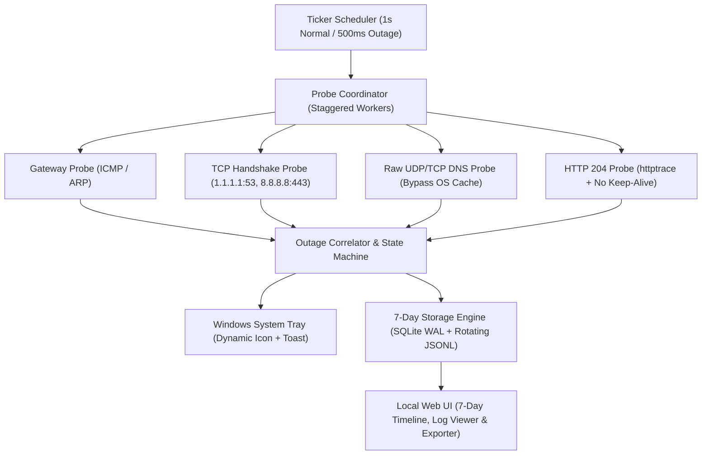
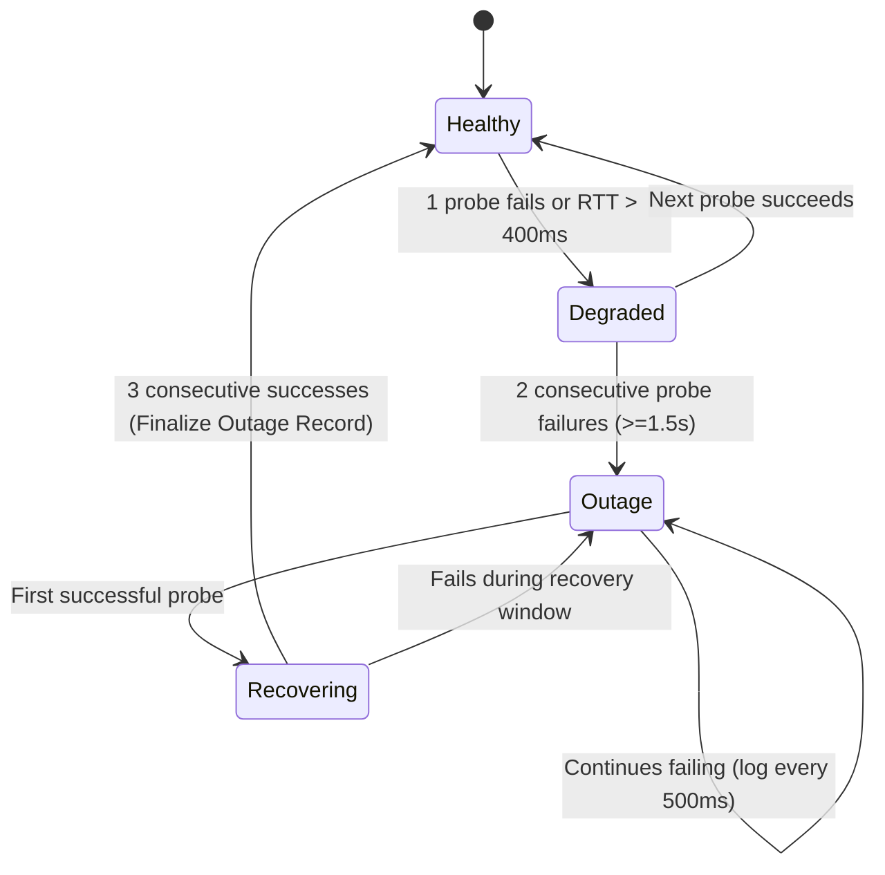

# NetScan: Go Windows Internet Stability Monitor — Research & Architecture

## 1. Problem Statement & Core Constraints

Detecting intermittent internet drops lasting **10 seconds or less** and retaining a full **7+ day historical audit trail** requires a specialized probing and storage architecture:

1. **OS & Runtime Caching Masks Micro-Drops**: Windows caches DNS responses (`dnscache`), and Go's default `http.Transport` reuses idle TCP connections and relies on OS timeouts that often exceed 15–30 seconds.
2. **Nyquist Sampling for ≤10s Outages**: To reliably detect and measure a 2–10 second drop (and distinguish a single lost packet from an actual outage), probes must execute every **1 to 2 seconds** with strict **1000ms–1500ms timeouts**, accelerating to **500ms** when degradation is detected.
3. **Isolating the Fault Domain**: When a 5-second drop occurs, the monitor must immediately record whether the failure happened at:
   - **Local Link / Gateway** (Wi-Fi drop or router hang)
   - **ISP / Routing Layer** (ICMP/TCP to public anycast IPs failing while local gateway succeeds)
   - **DNS Layer** (ISP or upstream resolver timeout while IP routing works)
   - **Application / HTTP Layer** (TLS handshake stall, proxy issue, or captive portal)
4. **7+ Day Historical Retention & Export**: Must store at least 7 days of continuous telemetry without excessive disk wear or memory bloat, and expose a local Web UI to browse, filter, and export logs in multiple formats (`CSV`, `JSON`, `JSONL`, and ISP diagnostic reports).



---

## 2. High-Frequency Multi-Protocol Probing Architecture

### 2.1 Why Standard Checks Fail on <10s Drops

| Failure Mode | Standard Go Behavior | Required Mitigation |
| :--- | :--- | :--- |
| **DNS Caching** | `net.LookupHost` hits Windows `Dnsapi.dll` cache, returning instant success during an outage. | Send raw DNS queries directly to upstream resolver IPs (`1.1.1.1:53`, `8.8.8.8:53`, `9.9.9.9:53`) over UDP/TCP with a custom dialer. |
| **HTTP Connection Pooling** | `http.DefaultTransport` reuses sockets; stalled sockets may wait for OS TCP retransmission timers (>15s). | Set `DisableKeepAlives: true` or use dedicated short-lived transports with `TLSHandshakeTimeout: 1500ms` and `ResponseHeaderTimeout: 1500ms`. |
| **Synchronized Bursting** | Firing all probes at `t=0` can saturate consumer router NAT tables or trigger rate limits. | Stagger probe workers across the 1000ms window (`t+0ms` ICMP, `t+250ms` DNS, `t+500ms` TCP, `t+750ms` HTTP). |
| **False Positives on Single Target** | A single target hiccup looks like an internet drop. | Probe at least 2 geographically/network-diverse anycast providers per cycle and correlate with local gateway reachability. |

### 2.2 Probe Specifications

#### A. HTTP/HTTPS Connectivity Probes (`net/http` + `net/http/httptrace`)
Instead of downloading full web pages, query dedicated zero-body connectivity endpoints that return `204 No Content`:
- Cloudflare: `http://cp.cloudflare.com/generate_204`
- Google: `http://connectivitycheck.gstatic.com/generate_204`
- Microsoft: `http://www.msftconnecttest.com/connecttest.txt`
- Apple: `http://captive.apple.com/hotspot-detect.html`

Using `httptrace.ClientTrace`, a single probe captures granular phase timings:
- `DNSStart` $\rightarrow$ `DNSDone`
- `ConnectStart` $\rightarrow$ `ConnectDone` (TCP RTT)
- `TLSHandshakeStart` $\rightarrow$ `TLSHandshakeDone`
- `GotFirstResponseByte` (TTFB)

```go
package probe

import (
	"context"
	"crypto/tls"
	"net"
	"net/http"
	"net/http/httptrace"
	"time"
)

type HTTPMetrics struct {
	Target       string        `json:"target"`
	StatusCode   int           `json:"status_code"`
	DNSDuration  time.Duration `json:"dns_duration_ns"`
	TCPDuration  time.Duration `json:"tcp_duration_ns"`
	TLSDuration  time.Duration `json:"tls_duration_ns"`
	TTFBDuration time.Duration `json:"ttfb_duration_ns"`
	Total        time.Duration `json:"total_duration_ns"`
	Error        string        `json:"error,omitempty"`
}

func ProbeHTTP(ctx context.Context, url string, timeout time.Duration) HTTPMetrics {
	var dnsStart, connStart, tlsStart, reqStart time.Time
	metrics := HTTPMetrics{Target: url}

	trace := &httptrace.ClientTrace{
		DNSStart:          func(_ httptrace.DNSStartInfo) { dnsStart = time.Now() },
		DNSDone:           func(_ httptrace.DNSDoneInfo) { metrics.DNSDuration = time.Since(dnsStart) },
		ConnectStart:      func(_, _ string) { connStart = time.Now() },
		ConnectDone:       func(_, _ string, _ error) { metrics.TCPDuration = time.Since(connStart) },
		TLSHandshakeStart: func() { tlsStart = time.Now() },
		TLSHandshakeDone:  func(_ tls.ConnectionState, _ error) { metrics.TLSDuration = time.Since(tlsStart) },
		WroteRequest:      func(_ httptrace.WroteRequestInfo) { reqStart = time.Now() },
		GotFirstResponseByte: func() {
			if !reqStart.IsZero() {
				metrics.TTFBDuration = time.Since(reqStart)
			}
		},
	}

	reqCtx, cancel := context.WithTimeout(httptrace.WithClientTrace(ctx, trace), timeout)
	defer cancel()

	transport := &http.Transport{
		DisableKeepAlives: true,
		DialContext: (&net.Dialer{
			Timeout: timeout,
		}).DialContext,
		TLSHandshakeTimeout:   timeout,
		ResponseHeaderTimeout: timeout,
	}

	client := &http.Client{
		Transport: transport,
		CheckRedirect: func(req *http.Request, via []*http.Request) error {
			return http.ErrUseLastResponse
		},
	}

	start := time.Now()
	req, err := http.NewRequestWithContext(reqCtx, http.MethodGet, url, nil)
	if err != nil {
		metrics.Error = err.Error()
		return metrics
	}

	resp, err := client.Do(req)
	metrics.Total = time.Since(start)
	if err != nil {
		metrics.Error = err.Error()
		return metrics
	}
	defer resp.Body.Close()

	metrics.StatusCode = resp.StatusCode
	return metrics
}
```

#### B. Direct DNS Resolver Probes (`github.com/miekg/dns` or Custom `net.Resolver`)
To bypass the Windows DNS Client service cache (`svchost.exe -k NetworkService -p -s Dnscache`):
- Use `github.com/miekg/dns` to send raw UDP/TCP `A` or `SOA` queries directly to `1.1.1.1:53`, `8.8.8.8:53`, and the local router's DNS forwarder.
- Optionally prepend a timestamp nonce label or query root/TLD SOA records to verify live upstream resolution rather than cached answers.

```go
package probe

import (
	"context"
	"net"
	"time"
)

func ProbeRawDNS(ctx context.Context, nameserver string, domain string, timeout time.Duration) (time.Duration, error) {
	resolver := &net.Resolver{
		PreferGo: true,
		Dial: func(ctx context.Context, network, address string) (net.Conn, error) {
			d := net.Dialer{Timeout: timeout}
			return d.DialContext(ctx, "udp", nameserver)
		},
	}

	queryCtx, cancel := context.WithTimeout(ctx, timeout)
	defer cancel()

	start := time.Now()
	_, err := resolver.LookupHost(queryCtx, domain)
	return time.Since(start), err
}
```

#### C. ICMP & TCP SYN Probes (Gateway vs. WAN Isolation)
- **ICMP on Windows**: `github.com/prometheus-community/pro-bing` uses the Win32 `IcmpSendEcho2` API (`iphlpapi.dll`), which works **without Administrator privileges**.
- **TCP Handshake**: `net.DialTimeout("tcp", "1.1.1.1:443", 1200*time.Millisecond)` measures pure 3-way TCP handshake RTT (`SYN` $\rightarrow$ `SYN-ACK`) and immediately closes the socket.
- **Default Gateway Check**: Discover the local default gateway IP via `GetBestInterface` / `GetIpForwardTable` (`golang.org/x/sys/windows`) and ping it concurrently. If WAN probes fail while the gateway responds in `<2ms`, the fault is confirmed as **ISP/Modem upstream** rather than local Wi-Fi/NIC.

#### D. Passive Windows Event Hooks
In addition to 1-second active polling, subscribe to Windows `NotifyIpInterfaceChange` and `NotifyRouteChange2` via `golang.org/x/sys/windows` to log sub-millisecond NIC disconnects, DHCP renewals, or Wi-Fi roaming events at the exact moment they happen.

---

## 3. Outage Detection State Machine

To handle intermittent drops (e.g., 2 to 10 seconds) without losing precision:



- **Adaptive Tick Acceleration**:
  - **Healthy State**: 1 probe cycle every `1000ms` (staggered across protocols).
  - **Degraded / Outage State**: Immediately accelerate to `500ms` multi-target parallel probes to measure the exact start/end timestamps of short 2–10 second drops with $\pm 0.5\text{s}$ accuracy, and persist all raw samples from the pre-outage ring buffer.

---

## 4. 7+ Day Historical Logging & Storage Architecture

### 4.1 Retention Sizing & Batch Write Strategy

At a 1-second tick interval, 7 days equals $7 \times 86,400 = 604,800$ seconds.
To avoid hammering the SSD with 4 individual disk writes per second while ensuring zero data loss and instant queries across a 7-to-30-day window:

1. **Buffered Batch Commits (Every 5 Seconds or Immediate on Outage)**:
   - Samples collect in memory and flush in a single SQLite transaction every 5 seconds (or immediately when an outage state transition occurs).
2. **Three-Table SQLite Schema (`modernc.org/sqlite` in WAL Mode)**:
   - `outage_events`: Every detected micro-outage, degradation event, or NIC state change with start/end timestamps, duration in ms, fault classification (`LOCAL_LINK`, `GATEWAY_UNREACHABLE`, `WAN_ROUTING`, `DNS_FAILURE`, `HTTP_TIMEOUT`), and packet loss stats. Retained for **30+ days** (tiny footprint).
   - `probe_samples`: Raw per-second / per-500ms protocol telemetry (`timestamp_ms`, `protocol`, `target`, `rtt_ms`, `dns_ms`, `tcp_ms`, `tls_ms`, `ttfb_ms`, `status_code`, `success`, `error_msg`, `outage_id`). Retained for **at least 7 days** (~50–70 MB on disk with indexes).
   - `minute_rollups`: Pre-aggregated 1-minute buckets (`min_rtt`, `max_rtt`, `avg_rtt`, `p95_rtt`, `jitter_ms`, `loss_pct` per protocol) so rendering a 7-day chart in the Web UI loads in `<5ms` without scanning 600,000 raw rows.
3. **Rotating Flat-File Logs (`lumberjack`)**:
   - Parallel structured `.jsonl` log (`logs/netscan-events.jsonl`) configured with `MaxAge: 7` (or `14` days), `MaxSize: 50` MB, and `Compress: true` for external tools.
4. **Automated Retention Pruner**:
   - A background ticker runs once per hour executing a bounded cleanup (`DELETE FROM probe_samples WHERE timestamp_ms < ?`) for records older than the configured retention period (default `7 days`, configurable to `14` or `30` days).

```sql
CREATE TABLE IF NOT EXISTS outage_events (
    id INTEGER PRIMARY KEY AUTOINCREMENT,
    start_ts_ms INTEGER NOT NULL,
    end_ts_ms INTEGER,
    duration_ms INTEGER,
    severity TEXT NOT NULL,
    classification TEXT NOT NULL,
    gateway_reachable INTEGER NOT NULL,
    gateway_rtt_ms REAL,
    failed_protocols TEXT NOT NULL,
    summary TEXT NOT NULL
);

CREATE INDEX IF NOT EXISTS idx_outage_start ON outage_events(start_ts_ms DESC);

CREATE TABLE IF NOT EXISTS probe_samples (
    id INTEGER PRIMARY KEY AUTOINCREMENT,
    ts_ms INTEGER NOT NULL,
    protocol TEXT NOT NULL,
    target TEXT NOT NULL,
    success INTEGER NOT NULL,
    rtt_ms REAL,
    dns_ms REAL,
    tcp_ms REAL,
    tls_ms REAL,
    ttfb_ms REAL,
    status_code INTEGER,
    error TEXT,
    outage_id INTEGER
);

CREATE INDEX IF NOT EXISTS idx_samples_ts_proto ON probe_samples(ts_ms DESC, protocol);
CREATE INDEX IF NOT EXISTS idx_samples_outage ON probe_samples(outage_id);

CREATE TABLE IF NOT EXISTS minute_rollups (
    bucket_ts_ms INTEGER NOT NULL,
    protocol TEXT NOT NULL,
    total_sent INTEGER NOT NULL,
    total_failed INTEGER NOT NULL,
    loss_pct REAL NOT NULL,
    min_rtt_ms REAL,
    avg_rtt_ms REAL,
    max_rtt_ms REAL,
    p95_rtt_ms REAL,
    jitter_ms REAL,
    PRIMARY KEY (bucket_ts_ms, protocol)
);
```

---

## 5. Web UI: 7-Day Log Explorer & Export Capabilities

The embedded HTTP server (`127.0.0.1:<port>`, bundled into the single `.exe` via Go `embed.FS`) serves both the interactive dashboard and REST/Export endpoints.

### 5.1 Web UI Views

1. **Live Status & Real-Time Strip Chart**:
   - Current state badge (`HEALTHY`, `DEGRADED`, `OUTAGE`), live RTT gauges for Gateway, ICMP, DNS, and HTTP, plus a live 60-second scrolling chart powered by Server-Sent Events (`GET /api/stream`).
2. **7-Day Stability Timeline & Heatmap**:
   - Visualizes all 7 days of `minute_rollups` and overlays red vertical markers for every `outage_event` (even 2–10s drops, which are pinned as high-priority markers so they never disappear into averages).
3. **Interactive Log Explorer Table**:
   - **Time Range Selector**: `Last 15m`, `Last 1h`, `Last 24h`, `Last 7 Days`, or custom start/end date-time picker.
   - **Filters**:
     - View Mode: `Outage Events Only`, `Failed Probes Only`, or `All Raw Samples`
     - Protocol Filter: `All`, `ICMP`, `DNS`, `TCP`, `HTTP`, `Gateway`
     - Classification Filter: `ISP/WAN Drop`, `DNS Timeout`, `Local Wi-Fi/Gateway Drop`, `High Latency`
   - **Outage Drill-Down Drawer**: Clicking any 3–10s outage opens a sub-second timeline showing the exact sequence of probes 15 seconds before, during, and after the drop.
4. **Export Center Modal / Toolbar**:
   - Allows exporting either the **currently filtered view** or the **entire 7-day dataset** with one click.

### 5.2 HTTP API & Export Endpoints

| Endpoint | Method | Description |
| :--- | :--- | :--- |
| `/api/status` | `GET` | Current connection state, uptime %, 24h & 7d outage counts, and latest RTT per protocol. |
| `/api/stream` | `GET` | Server-Sent Events (`text/event-stream`) pushing real-time probe results every second. |
| `/api/outages` | `GET` | Paginated & filterable list of outage events (`?from=...&to=...&classification=...`). |
| `/api/outages/{id}/samples` | `GET` | High-resolution probe samples surrounding a specific micro-outage. |
| `/api/logs` | `GET` | Paginated raw probe logs (`?from=...&to=...&protocol=...&failed_only=true`). |
| `/api/rollups` | `GET` | 1-minute aggregated metrics across the 7-day window for charting. |
| `/api/export/csv` | `GET` | Streams `Content-Disposition: attachment; filename="netscan-logs-7d.csv"` (`type=outages` or `type=samples`). |
| `/api/export/json` | `GET` | Downloads formatted JSON array of outages and/or samples for the selected window. |
| `/api/export/jsonl` | `GET` | Streams newline-delimited JSON (`.jsonl`) for log processors. |
| `/api/export/isp-report` | `GET` | Generates a standalone, human-readable ISP Evidence Report (`.txt` or `.html`) summarizing total drops, durations, gateway proof (proving local LAN stayed up while ISP dropped), and timestamped incident logs. |
| `/metrics` | `GET` | Prometheus text format metrics. |

---

## 6. Windows System Tray & UI Options in Go

| Approach | Libraries | Binary Size | RAM Usage | Pros & Cons |
| :--- | :--- | :--- | :--- | :--- |
| **1. System Tray + Local Web UI (Recommended)** | `fyne.io/systray` + `net/http` (`embed.FS`) | ~10–14 MB | ~15–25 MB | **Pros**: Minimal background CPU/RAM, zero WebView memory overhead when closed, opens Web UI URL link directly in the default web browser, closing the browser tab leaves the tray monitor running uninterrupted.<br>**Cons**: Relies on user's installed web browser when viewing UI. |
| **2. Wails v2 / v3 (Embedded WebView2 Window + Tray)** | `github.com/wailsapp/wails/v2` + `fyne.io/systray` | ~14–18 MB | ~45–85 MB | **Pros**: Dedicated native window frame with `HideWindowOnClose: true`.<br>**Cons**: Keeps WebView2 process resident in memory unless explicitly destroyed. |

### Dismiss-to-Tray Workflow
1. **Build Flag**: Compiled with `-ldflags "-H=windowsgui"` so no terminal window appears.
2. **Window Close Behavior**:
   - In **Browser Mode**: The Go daemon lives in the Windows System Tray continuously. Clicking **"Open Dashboard"** or double-clicking the tray icon opens `http://127.0.0.1:<port>` as a URL link in the default browser. Closing that browser tab leaves the tray monitor running uninterrupted.
   - Tray right-click menu provides:
     - `Status: Connected (12ms)` (live status line)
     - `Open Dashboard & Log Viewer`
     - `Quick Export Last 7 Days (CSV)`
     - `Pause Monitoring`
     - `Start with Windows` (Registry `HKCU\Software\Microsoft\Windows\CurrentVersion\Run` toggle)
     - `Exit`

---

## 7. Recommended Go Package Stack

| Component | Package | Reason |
| :--- | :--- | :--- |
| **ICMP Ping** | `github.com/prometheus-community/pro-bing` | Native Windows `IcmpSendEcho2` support without requiring Admin rights. |
| **DNS Probing & Local DNS Server** | `github.com/miekg/dns` | Direct UDP/TCP DNS queries bypassing OS cache, plus optional local DNS TXT status responder. |
| **HTTP Tracing** | `net/http` + `net/http/httptrace` (Stdlib) | Granular DNS, TCP, TLS, and TTFB timing with keep-alives disabled. |
| **Windows APIs** | `golang.org/x/sys/windows` | Default gateway discovery, NIC change notifications, single-instance mutex. |
| **System Tray** | `fyne.io/systray` | Lightweight Win32 system tray icon, dynamic tooltips, and context menus. |
| **SQLite Storage** | `modernc.org/sqlite` | Pure-Go SQLite driver (no CGO/MinGW needed) for 7+ day indexed history and fast exports. |
| **Log Rotation** | `log/slog` + `gopkg.in/natefinch/lumberjack.v2` | Automatic 7-day file rotation for `.jsonl` logs. |

---

## 8. Proposed Project Structure

```text
netscan/
├── cmd/
│   └── netscan/
│       ├── main.go
│       └── syso/
├── internal/
│   ├── config/
│   │   └── config.go
│   ├── probe/
│   │   ├── coordinator.go
│   │   ├── http.go
│   │   ├── dns.go
│   │   ├── tcp.go
│   │   ├── icmp.go
│   │   └── gateway_windows.go
│   ├── detector/
│   │   └── state.go
│   ├── storage/
│   │   ├── sqlite.go
│   │   ├── retention.go
│   │   ├── export.go
│   │   └── filelog.go
│   ├── server/
│   │   ├── http.go
│   │   ├── dns_status.go
│   │   └── web/
│   │       ├── index.html
│   │       ├── app.js
│   │       └── styles.css
│   └── tray/
│       ├── tray_windows.go
│       └── icons.go
└── go.mod
```
